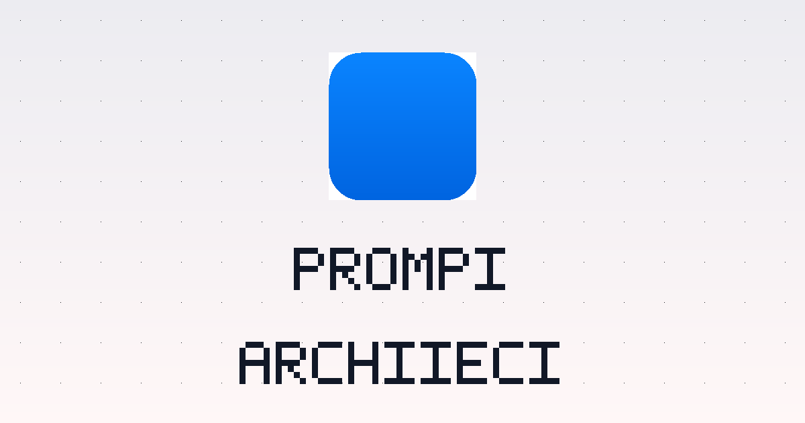

<div align="center">



# Prompt Architect

**Design precise, production-ready development prompts for AI coding assistants.**

Checkboxes, tech-stack dropdowns, presets, and one-click export. Zero dependencies, offline-first, installable as a PWA.

[Live app](https://sajiloprompt.vercel.app) &middot; [Report a bug](../../issues) &middot; [Contribute](CONTRIBUTING.md)

</div>

---

## What it does

Pick the requirements you want every generated project to follow (security, testing, performance, CI/CD, design system, and 20 more sections), tune the details with dropdowns and text fields, and Prompt Architect assembles them into **one clean, structured development prompt** your AI coding assistant can follow without guessing.

## Features

- **22 requirement sections** covering security, testing, performance, PWA, SEO/AEO, deployment, CI/CD, and development workflow rules.
- **Mixed controls** in one canvas: checkboxes, dropdowns, and free-text inputs.
- **Conditional sections**: pick *PWA* as the project type and the PWA section appears automatically.
- **Live preview** with Markdown, JSON, YAML, and plain-text export.
- **Presets**: save your favourite stacks, export/import them as JSON, or load one of the built-in starters.
- **Prompt history** (last 20) and **undo/redo** (last 50 steps).
- **Paste-and-match import**: paste an old prompt and the tool auto-selects matching requirements.
- **Shareable URLs**: any configuration fits in the URL hash.
- **Full keyboard shortcuts** with an in-app reference (`?`).
- **Offline PWA**: installable, works offline, custom offline and 404 pages.
- **SEO/AEO/GEO ready**: Open Graph cards, Twitter cards, and JSON-LD structured data.

## Quick start

Prompt Architect is a single-page, zero-build vanilla app. Serve it statically:

```bash
# clone
git clone https://github.com/arundada9000/prompt.git
cd prompt

# serve locally
python -m http.server 8123
# or: npx serve .
```

Open <http://localhost:8123> and start building prompts.

## Keyboard shortcuts

| Shortcut | Action |
| --- | --- |
| `Ctrl/Cmd + K` | Focus search |
| `Ctrl/Cmd + Z` / `Shift + Z` | Undo / Redo |
| `Ctrl/Cmd + Shift + C` | Copy prompt |
| `Ctrl/Cmd + S` | Download prompt |
| `Ctrl/Cmd + Shift + P` | Save preset |
| `Ctrl/Cmd + Shift + I` | Import prompt |
| `Ctrl/Cmd + Shift + H` | Prompt history |
| `Ctrl/Cmd + Shift + F` | Fullscreen preview |
| `Ctrl/Cmd + Shift + E` | Export menu |
| `1` - `9` | Jump to a section |
| `?` | Shortcuts reference |
| `Esc` | Close modal / fullscreen |

## Project structure

```text
prompt/
  index.html          entry point, SEO + structured data
  manifest.json       PWA manifest
  sw.js               service worker (offline-first, caches app shell)
  404.html            custom on-brand 404 page
  offline.html        custom offline page
  vercel.json         deployment config
  og-image.png        social share image
  css/                iOS design-token stylesheets
  js/
    features.js       section + requirement definitions
    state.js          selections, presets, history, undo/redo, URL hash
    presets.js        built-in factory presets + file import/export
    content.js        journal articles
    prompt-builder.js prompt assembly + export + paste-match
    renderer.js       DOM rendering
    interactions.js   scroll/spy, active nav
    circular-nav.js   mobile gesture nav
    app.js            event wiring, shortcuts, PWA, welcome flow
  icons/              logo source + generated PWA icons
  docs/               architecture, deployment, SEO, privacy
```

## Tech stack

| Layer | Choice |
| --- | --- |
| Language | Vanilla JavaScript (ES2021) |
| Markup | Semantic HTML5 |
| Styling | Hand-rolled CSS with iOS HIG-inspired design tokens |
| Storage | `localStorage` (no backend, no accounts) |
| Deployment | Vercel (static) |

No frameworks. No build step. No dependencies. Every asset is in this repository.

## Data & privacy

Everything stays in your browser. No accounts, no analytics, no tracking, no network calls at runtime (only the optional service worker). See [docs/PRIVACY.md](docs/PRIVACY.md).

## Deployment

Ready for Vercel with a one-click import. See [docs/DEPLOYMENT.md](docs/DEPLOYMENT.md).

## Documentation

- [Architecture](docs/ARCHITECTURE.md)
- [Development guide](docs/DEVELOPMENT.md)
- [Deployment](docs/DEPLOYMENT.md)
- [SEO / AEO / GEO](docs/SEO.md)
- [Privacy](docs/PRIVACY.md)

## License

Released under the [MIT License](LICENSE.md).

## Built by

Arun Neupane ([arundada9000](https://github.com/arundada9000)) &middot; [Portfolio](https://arunneupane.vercel.app) &middot; CTO & Lead Architect at [Sajilo Digital Pvt. Ltd.](https://sajilodigital.com.np)

> "I like to code till I don't like to code. (It never happens.)"